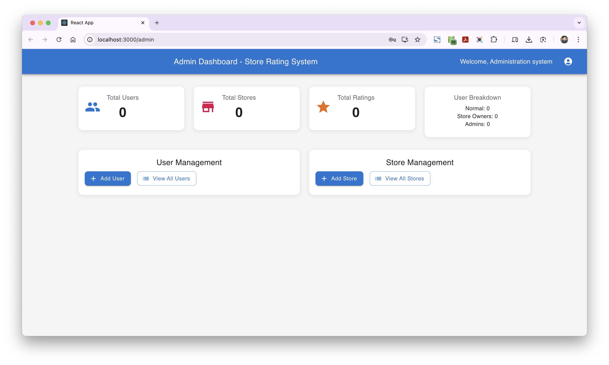

# Store Rating Platform

A full-stack application for discovering stores and submitting ratings. It includes a role-based admin console, store-owner dashboard, and rating tools for regular users.



## Features

- **System administrators** can review platform totals, manage users and stores, assign store owners, filter and sort listings, and view user details.
- **Normal users** can create an account, search stores, submit one rating per store, and update or delete their ratings.
- **Store owners** can view their store's average rating and a sortable, paginated list of customers who rated it.
- A shared login flow routes each account to the appropriate area based on its role.
- Password changes, server-side validation, paginated APIs, and database-maintained rating aggregates are included.

## Technology

| Area | Stack |
|---|---|
| Frontend | React, TypeScript, Vite, Material UI, React Router |
| Backend | Node.js, Express |
| Database | PostgreSQL |
| Authentication | JWT bearer tokens; passwords hashed with bcrypt |
| Validation | express-validator on the API; Yup and React Hook Form in the UI |

## Requirements

- Node.js and npm compatible with the dependencies in the lockfiles
- PostgreSQL
- Git

## Local setup

### 1. Clone and install dependencies

```bash
git clone https://github.com/pr667/STORE-RATING-PLATFORM.git
cd Store-Rating-Platform
npm install
cd client
npm install
cd ..
```

### 2. Create a PostgreSQL database

Create a database and a database user with permission to create and update tables. For example, from `psql`:

```sql
CREATE DATABASE store_rating_db;
```

### 3. Configure the backend

Copy `.env.example` to `.env` and set the values for your local environment. In PowerShell:

```powershell
Copy-Item .env.example .env
```

In Bash or macOS/Linux shells:

```bash
cp .env.example .env
```

Set the PostgreSQL connection values, an administrator email and password, and a JWT secret of at least 32 characters. Keep `.env` private and out of Git.

The main backend settings are:

| Variable | Purpose |
|---|---|
| `DB_HOST`, `DB_PORT` | PostgreSQL host and port |
| `DB_NAME`, `DB_USER`, `DB_PASSWORD` | Database name and credentials |
| `JWT_SECRET`, `JWT_EXPIRE` | JWT signing secret and token lifetime |
| `PORT` | API port; defaults to `5001` |
| `NODE_ENV` | Set to `development` locally or `production` when deployed |
| `CLIENT_URL` | Frontend origin allowed by CORS; defaults to `http://localhost:3000` |
| `ADMIN_EMAIL`, `ADMIN_PASSWORD`, `ADMIN_NAME` | Initial system administrator account |

Initialize or migrate the database and create the configured administrator:

```bash
node scripts/init-db.js
```

The initialization script is safe to run again. It creates development sample data outside production; sample data is disabled when `NODE_ENV=production`.

### 4. Configure the frontend

Create `client/.env` with the API base URL:

```env
VITE_API_URL=http://localhost:5001/api
```

### 5. Start the application

Run the backend from the repository root:

```bash
npm start
```

Run the Vite frontend in another terminal:

```bash
cd client
npm run dev
```

Open [http://localhost:3000](http://localhost:3000). The API runs at [http://localhost:5001](http://localhost:5001) by default and exposes a health check at `/api/health`.

## Roles and permissions

Roles are stored in uppercase:

- `SYSTEM_ADMIN` — manages users and stores and views platform statistics.
- `NORMAL_USER` — signs up, searches stores, and manages personal ratings.
- `STORE_OWNER` — views their assigned store and its ratings.

The API enforces authorization independently of frontend route guards. Each store can have at most one owner. Removing an owner leaves the store in place with no assigned owner.

## API overview

All API routes are prefixed with `/api`. Protected endpoints use `Authorization: Bearer <token>`.

| Route group | Representative endpoints | Access |
|---|---|---|
| `/auth` | `POST /register`, `POST /login`, `GET /profile`, `POST /change-password`, `POST /verify-token` | Public registration/login; authenticated profile and password actions |
| `/users` | `GET /`, `GET /:id`, `PUT /:id`, `DELETE /:id`, `GET /stats/dashboard` | Administrator listing and management; users may read their own details |
| `/stores` | `GET /`, `GET /:id`, `GET /my-store`, `GET /my-store/ratings`, `POST /`, `PUT /:id`, `DELETE /:id` | Role-specific; store creation and deletion are administrator-only |
| `/ratings` | `POST /`, `PUT /:storeId`, `DELETE /:storeId`, `GET /my-ratings`, `GET /store/:storeId`, `GET /user/:userId`, `GET /stats` | Users manage their own ratings; administrative and owner reads are restricted by role and ownership |
| `/admin` | `GET /dashboard`, `GET /users`, `GET /stores`, `GET /store-owners`, `POST /users`, `POST /stores` | Administrator-only |

Ratings are integers from 1 to 5. User and store names must be 20–60 characters; addresses are limited to 400 characters. Passwords must be 8–16 characters and include an uppercase letter and a special character.

## Development and verification

From `client/`:

```bash
npx tsc --noEmit
npm run lint
npm run build
```

The API smoke suite requires a running backend, an initialized development database, and the configured administrator account:

```bash
node scripts/smoke-test.js
```

It exercises authentication, role checks, user and store management, rating operations, database rating aggregates, and cleanup of its temporary records.

## Security notes

- Never commit `.env` or production credentials. Use `.env.example` as a template.
- Production startup rejects placeholder JWT secrets and secrets shorter than 32 characters.
- Production request limiting is stricter than the development limit.
- Configure `CLIENT_URL` to the exact deployed frontend origin and use HTTPS in production.

## Project layout

```text
.
├── client/                 # React, TypeScript, and Vite application
│   └── src/
│       ├── components/
│       ├── contexts/
│       └── pages/
├── config/database.js      # PostgreSQL pool, schema, and migrations
├── middleware/             # Authentication and validation
├── routes/                 # Express API routes
├── scripts/                # Database initialization and smoke test
├── server.js               # Express server entry point
└── .env.example            # Backend environment template
```
